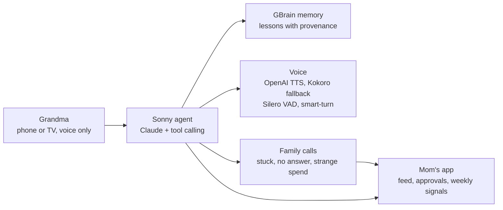

# Sonny

**The AI that knows when to call mom.**

Sonny is a voice agent for parents who live alone. Grandma just talks to it on her phone or her TV, every call doubles as a quiet health and memory check-up, and mom gets a call only when Sonny is stuck, grandma does not answer, or something looks strange.

[Live demo](https://sonny-nine.vercel.app/?demo=1) · [Demo video](https://youtu.be/WY7xkU4z6yI) · Built at c0mpiled-17 Seoul (YC RFS: AI for the Aging Population)

<p align="center">
  
  &nbsp;&nbsp;
  
</p>

## Built on GBrain + gstack

Sonny's long-term memory is [GBrain](https://github.com/garrytan/gbrain) on keyless local PGLite (`gbrain init --pglite --no-embedding`, home `~/.hyodo-tv/gbrain-home`): no embeddings, no model calls, nothing leaves the machine.

| What grandma does | Stored in GBrain as | Code |
|---|---|---|
| Teaches a tip ("brine kimchi overnight") | fact `[lesson] ...` on entity `grandma-run-N`, with provenance and `valid_from` | [`gbrain-store.ts`](src/lib/memory/gbrain-store.ts) |
| Teaches a new skill ("my usual Sunday groceries") | fact `[skill] ...`, replayed step by step later | [`skills.ts`](src/lib/agent/skills.ts), [`tools.ts`](src/lib/agent/tools.ts) |
| Mentions health or family ("my grandson is Max") | fact `[health] ...` / `[family] ...` | [`types.ts`](src/lib/memory/types.ts) |
| Corrects herself ("Wednesday, not Tuesday") | new fact with `--replaces`, old one kept on record | [`gbrain-store.ts`](src/lib/memory/gbrain-store.ts) |
| Demo reset | a new run entity, nothing forgotten | [`gbrain-store.ts`](src/lib/memory/gbrain-store.ts) |
| Anything said | privacy tier `family` / `summary` / `private`, redacted on the server before mom sees it | [`privacy.ts`](src/lib/memory/privacy.ts), [`view.ts`](src/app/api/family/view.ts) |

Our contribution back: a reusable [family privacy-tiered memory recipe](docs/gbrain/family-privacy-memory.md) for GBrain apps. Usage log: [`docs/gstack/gbrain-usage.md`](docs/gstack/gbrain-usage.md).

gstack: we ran `/office-hours` ([notes](docs/gstack/office-hours.md)) and `/review` at the feature freeze, and fixed 4 of the bugs it caught (agent timeout, double approve, "No, don't approve" heard as yes, English brain errors in mom's feed): [`docs/gstack/review.md`](docs/gstack/review.md).

## The problem

- 63 million Americans are family caregivers, 1 in 4 adults, giving about 27 hours a week (National Alliance for Caregiving and AARP, Caregiving in the U.S. 2025).
- About half of dementia in the U.S. goes undiagnosed (45%, 2026 cohort study).
- Mom is already grandma's remote assistant: she books the ride from her own phone, then calls to check. The call home turns into a chore list.

## What Sonny does

1. **Grandma just talks.** She taps one icon and says what she needs: a ride, a show on TV, a note to a friend. No app to learn, no password to type.
2. **Every call is a quiet check-up.** Sonny weaves sleep, recall and daily blood-pressure questions into normal conversation, tracks weekly signals, and sends mom a simple report. A wellness check, not a diagnosis.
3. **Sonny knows when to call mom.** When grandma is stuck, does not answer, or a payment looks strange, mom's phone rings. Otherwise she sees what got done, never what was said.

## Try it in 60 seconds

Open grandma and mom on two devices, tap **Answer** on grandma's phone, and ask for a taxi. When grandma gets stuck, mom's phone rings.

| Who | Open this |
|---|---|
| Grandma's phone | https://sonny-nine.vercel.app/?demo=1 |
| Mom's phone | https://sonny-nine.vercel.app/family?demo=1 |
| Grandma's TV | https://sonny-nine.vercel.app/tv?demo=1 |

| Grandma's phone (`/`) | Mom's phone (`/family`) | TV mode (`/tv`) |
|---|---|---|
|  |  |  |

## How it works



- **Agent:** Claude through the Vercel AI SDK, calling real tools (memory, schedule, ride, TV guide, spend limits, call the guardian, family message).
- **Memory:** [GBrain](https://github.com/garrytan/gbrain), keyless local PGLite. Every lesson is stored with its source and can be corrected or withdrawn.
- **Voice:** OpenAI `gpt-4o-mini-tts` speaks (voices cedar and marin, chosen by the family), with [Kokoro](https://github.com/hexgrad/kokoro) as the self-hosted fallback. [Silero VAD](https://github.com/snakers4/silero-vad) listens hands-free, [smart-turn](https://github.com/pipecat-ai/smart-turn) decides whether an older speaker has finished or is only pausing, and [faster-whisper](https://github.com/SYSTRAN/faster-whisper) transcribes when the browser cannot.
- **Privacy:** redaction happens on the server ([`src/app/api/family/view.ts`](src/app/api/family/view.ts)); private lines never reach mom's phone, not even in the network panel. There is no camera.
- **Sign-in:** signed httpOnly cookies, one-QR device pairing, [`src/proxy.ts`](src/proxy.ts) as the first gate.

More: [architecture](docs/ARCHITECTURE.md), [open source credits and licenses](docs/OPEN_SOURCE.md), [family app contract](docs/family-app-contract.md).

## Built with GBrain and gstack

- **GBrain is Sonny's long-term memory.** Every skill grandma teaches ("my usual ride to Dr. Lee", "a note to Martha") is stored in GBrain with its source, and can be corrected or withdrawn. Code: [`src/lib/memory/gbrain-store.ts`](src/lib/memory/gbrain-store.ts). Usage log: [`docs/gstack/gbrain-usage.md`](docs/gstack/gbrain-usage.md).
- **gstack shaped the build.** We ran gstack `/office-hours` to pressure-test the idea ([`docs/gstack/office-hours.md`](docs/gstack/office-hours.md), [run log](docs/gstack/office-hours-run.md)) and gstack `/review` at the feature freeze, which found nine serious issues; we fixed the ones that could break the demo, including "No, don't approve" being heard as a yes ([`docs/gstack/review.md`](docs/gstack/review.md)).

## What's real, what's mocked

**Real:** the Claude agent and its tool calls, GBrain memory, the voice stack, mom's spend limits and approvals, Sonny's calls to mom (struggle, nudge and over-limit), the health check-ins, and the skills grandma teaches by talking.

**Mocked:**
- Ride and shopping services: there is no real taxi or store API behind them.
- Account connection: no real credentials are stored.
- Payments: top-ups are demo credits, or Stripe Checkout in test mode when `STRIPE_SECRET_KEY` is set.
- TV integration: the TV app runs in the browser today (`/tv`); Android TV and Samsung TV apps are next.

**Demo video:** the live-action B-roll is AI-generated footage. Every app screen in it is the real product.

## Go-to-market

1. **Today, families:** mom sends one link, grandma taps once, and the icon sits on her home screen. No sign-up, no password, no app store for grandma. The family pays monthly.
2. **Next, built into her TV:** the same Sonny as an Android TV and Samsung TV app the family installs remotely. Americans 75+ watch 4.4 hours of TV a day (BLS ATUS 2025), and 61% of U.S. internet homes stream mainly on the smart TV (Parks Associates 2026).
3. **Then, home-care agencies and senior health plans:** the channels that already sit in her home, and want the daily blood-pressure and memory check-ins.

## Run locally

Requirements: Node.js 22+, pnpm, an Anthropic API key. Optional: an OpenAI key for the warmer voice, and Python with faster-whisper for the speech-to-text fallback (see [`docs/stt.md`](docs/stt.md)).

```bash
pnpm install
```

```bash
pnpm build
```

```bash
pnpm start
```

- `pnpm dev` and `pnpm start` read `ANTHROPIC_API_KEY` and `OPENAI_API_KEY` from the macOS keychain, so no key lives in any file. On another machine, set both in your shell and run `pnpm exec next start`. Without an OpenAI key, Sonny speaks with Kokoro.
- Open http://localhost:3000.

| Screen | Address | Who |
|---|---|---|
| Grandma's phone | `/` | A paired phone. Add it to the home screen. |
| TV mode | `/tv` | The same Sonny on a TV |
| Family app | `/family` | Mom, signed in |
| Family admin | `/admin` (overview, today, taught, routines, allowance, privacy, device) | Mom, signed in |
| Hidden setup on grandma's phone | `/setup` (hold the top-left corner of `/` for 2 seconds) | Family, with the PIN |

### Demo accounts (test values only)

- Family sign-in at `/login`: `mom@sonny.demo` (Sarah, daughter, admin) or `mike@sonny.demo` (Mike, son), password `grandma-demo` for both. Every action is logged with the family member's name.
- Skip sign-in anywhere with `?demo=1`: `/?demo=1` (be grandma), `/admin?demo=1` (be her daughter).
- Family PIN for `/setup`: `0000`.
- Pair a real phone: `/admin/device`, "Connect grandma's phone", scan the QR with her phone.

### Settings

| Variable | What it does |
|---|---|
| `ANTHROPIC_API_KEY` | The agent (read from the keychain by the scripts above) |
| `OPENAI_API_KEY` | Sonny's voice (`gpt-4o-mini-tts`). Optional: Kokoro is the fallback. |
| `AUTH_SECRET` | Signs session cookies. Set it in any real deployment; there is a development fallback. |
| `FAMILY_PIN` | PIN for the hidden setup screen (demo `0000`) |
| `STRIPE_SECRET_KEY` | Turns top-ups into Stripe Checkout (test mode). Without it, top-ups are demo credits. |
| `AUTH_MODE=off` | Turns sign-in off (emergency switch for a live demo) |
| `STT_URL` | Local speech-to-text and turn-detection server (default `http://127.0.0.1:3201`) |

Rehearsal helpers: `POST /api/family/calls/demo?demo=1` rings mom's phone with a test call (`{"reason":"struggle"}`, `{"reason":"nudge"}`, or a spend over the limit).

## Repo map

| Path | What lives there |
|---|---|
| [`src/app`](src/app) | Next.js App Router: grandma's phone (`/`), TV (`/tv`), family app (`/family`), admin, sign-in, and the `api/` routes (agent, turn, tts, stt, family, events) |
| [`src/components/orb`](src/components/orb) | Grandma's one-icon screen: the Sonny orb and parrot looks, the call UI |
| [`src/components/family`](src/components/family) | Mom's phone: feed, incoming Sonny call, weekly signals, health card, allowance |
| [`src/components/tv`](src/components/tv) | TV mode: broadcast screen, channel lineup, pairing QR, Sonny on the TV |
| [`src/lib/agent`](src/lib/agent) | The Sonny agent: persona, tool definitions, wellness plan, watch and escalation rules, wallet |
| [`src/lib/memory`](src/lib/memory) | Long-term memory on GBrain (with a JSON store fallback), search and seed facts |
| [`src/lib/tts`](src/lib/tts) | Speech out: OpenAI TTS, Kokoro fallback, player and ringer |
| [`src/lib/voice`](src/lib/voice) | Speech in: voice activity detection, listening, speech-to-text client |
| [`docs/gstack`](docs/gstack) | Records of how we used gstack and GBrain during the build |
| [`docs/pitch`](docs/pitch) | Pitch, 90 second demo script, shot list, Q&A and the submission text |
| [`docs`](docs) | Architecture, open source credits, agent scenarios, STT and TV notes. Start at [`docs/README.md`](docs/README.md) |
| [`scripts`](scripts) | Local speech-to-text server, TV guide check, VAD asset copy used by `pnpm dev` and `pnpm build` |

## Why we built it

The founder's grandmother lives alone. The morning of this hackathon, the founder's mom booked her taxi to the doctor from her own phone, then called to check. Mom is already grandma's assistant. Sonny takes the job, and calls mom only when it matters.
