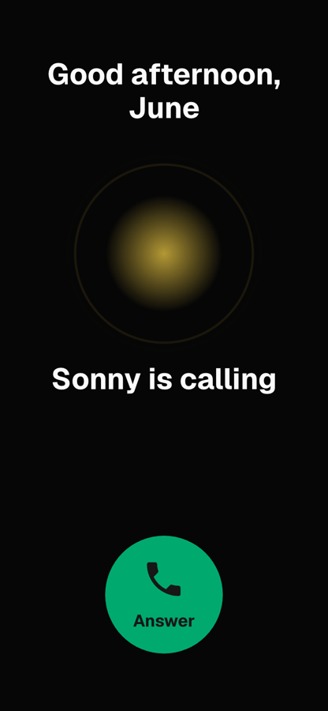
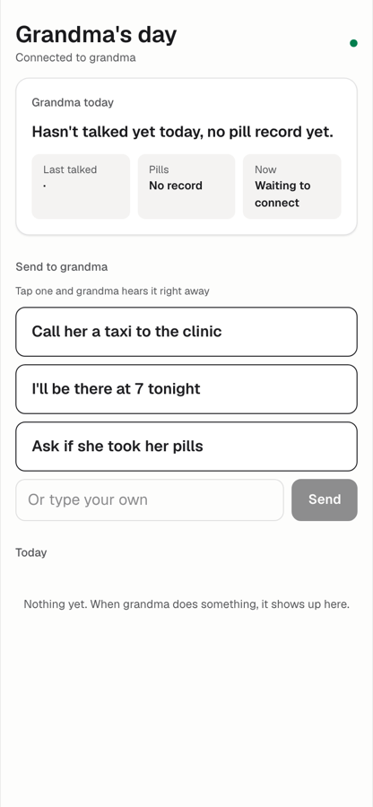
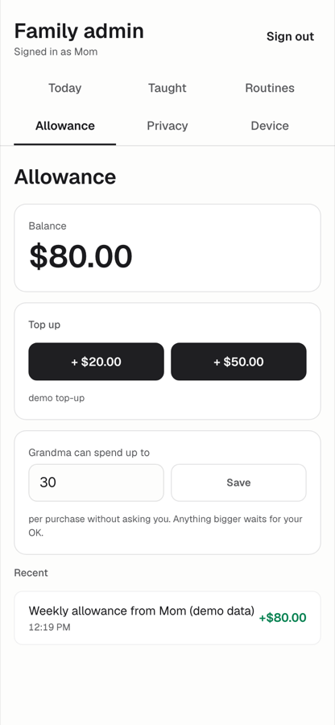
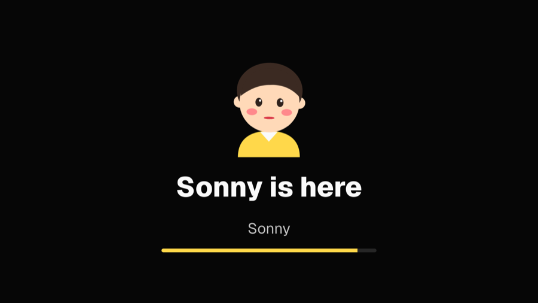

# Sonny

**Grandma says it. Sonny does it.**

Sonny is an AI errand runner for parents who live alone: grandma says it, Sonny does it. She taps one icon and gives the orders out loud.
Mom funds an allowance and holds the veto; Sonny calls her only when something is big, strange, or grandma is stuck.
Grandma builds new skills just by talking ("learn to get me my usual ride"). Anything that needs an account or a card, mom connects once from her phone, so grandma never types a password.

Built at c0mpiled-17 Seoul, 2026-11-09 (YC Request for Startups, Fall 2026: AI for the Aging Population).

## What Sonny does

1. **Say it, the allowance pays.** Grandma asks out loud for a taxi or her groceries; Sonny books and pays from an allowance her daughter tops up. Anything over the per-purchase limit waits for mom.
2. **Sonny calls first.** One icon on her phone, no app to learn. Sonny opens every moment as a phone call she only has to answer: pills, weather, the day ahead.
3. **Teach it once.** Grandma teaches Sonny how she likes things done ("my Sunday groceries", "a note to Martha", "learn to get me my usual ride"), once, and Sonny does it her way from then on. Her lessons become its long-term memory. Anything that needs an account or a card, mom connects once from her phone, so grandma never types a password.
4. **Mom only when it matters.** When grandma gets stuck, Sonny doesn't make her feel slow; it quietly calls mom ("Book it for her" or "I'll call her"). A strange order gets a double-check, then a call. And when grandma has been quiet, Sonny nudges mom to call, with something to talk about.
5. **Health check-ins.** Sonny calls for a daily blood-pressure reading and a weekly two-minute memory check, then sends mom a simple report. A wellness check, not a diagnosis.

Mom sees what got done, never what was said: grandma's private conversations are redacted on the server, and "don't tell my daughter" stays between them. There is no camera.

## Screens


Sonny is a little yellow cockatiel. Parrots learn by repeating what you teach them, and so does Sonny.

| Grandma's phone (`/`) | Mom's phone (`/family`) | Allowance (`/admin/allowance`) |
|---|---|---|
|  |  |  |

| Hidden setup (`/setup`) | TV mode (`/tv`) |
|---|---|
|  |  |

Screenshots live in `docs/screens/`.

## Run it

Requirements: Node.js 22+, pnpm, an Anthropic API key. Optional: Python with faster-whisper for the speech-to-text fallback (see `docs/stt.md`).

```bash
pnpm install
```

```bash
pnpm build
```

```bash
pnpm start
```

- `pnpm dev` and `pnpm start` read `ANTHROPIC_API_KEY` from the macOS keychain item `anthropic-hackathon-key`, so no key lives in any file. On another machine, set `ANTHROPIC_API_KEY` in your shell and run `pnpm exec next start`.
- Open http://localhost:3000.

| Screen | Address | Who |
|---|---|---|
| Grandma's phone | `/` | A paired phone. Add it to the home screen. |
| TV mode | `/tv` | The next step: the same Sonny on a TV |
| Family admin | `/admin` (overview, today, taught, routines, allowance, privacy, device) | Mom, signed in |
| Hidden setup on grandma's phone | `/setup` (hold the top-left corner of `/` for 2 seconds) | Family, with the PIN |

### Demo accounts (test values only)

- Family sign-in at `/login`: `mom@sonny.demo` (Sarah, daughter, admin) or `mike@sonny.demo` (Mike, son), password `grandma-demo` for both. Each family member sees grandma's feed and approvals; every action and top-up is logged with their name. On `/family` the demo can switch between them.
- Skip sign-in anywhere with `?demo=1`: `/?demo=1` (be grandma), `/admin?demo=1` (be her daughter).
- Family PIN for `/setup`: `0000`.
- Pair a real phone: `/admin/device`, "Connect grandma's phone", scan the QR with her phone.

### Settings

| Variable | What it does |
|---|---|
| `ANTHROPIC_API_KEY` | The agent (read from the keychain by the scripts above) |
| `AUTH_SECRET` | Signs session cookies. Set it in any real deployment; there is a development fallback. |
| `FAMILY_PIN` | PIN for the hidden setup screen (demo `0000`) |
| `STRIPE_SECRET_KEY` | Turns allowance top-ups into Stripe Checkout (test mode). Without it, top-ups are demo credits. |
| `AUTH_MODE=off` | Turns sign-in off (emergency switch for a live demo) |
| `STT_URL` | Local speech-to-text and turn-detection server (default `http://127.0.0.1:3201`) |

Rehearsal helpers: `POST /api/family/calls/demo?demo=1` rings mom's phone with a test call (`{"reason":"struggle"}`, `{"reason":"nudge"}`, or a spend over the limit).

## How it is built

```
Grandma's phone (/)                         Mom's phone (/admin)
  one icon, a particle, voice in/out          today, approvals, allowance, "Sonny is calling"
        |                                                ^
        v                                                |
  Claude agent (Vercel AI SDK, tool calling) ---- family inbox and activity log
     tools: memory, schedule, ride, order, allowance, call the guardian, TV guide, family message
        |
  GBrain memory   Kokoro voice   Silero VAD   smart-turn   faster-whisper
  (lessons with   (speech out,   (hands-free  (has she     (speech to text
   provenance)     on our server) listening)   finished?)   fallback)
```

- **Agent:** Claude through the Vercel AI SDK, calling real tools. The ride service is mocked; Stripe runs in test mode.
- **Memory:** [GBrain](https://github.com/garrytan/gbrain), keyless local PGLite. Every lesson is stored with its source and can be corrected or withdrawn. Usage log: [docs/gstack/gbrain-usage.md](docs/gstack/gbrain-usage.md).
- **Voice:** [Kokoro](https://github.com/hexgrad/kokoro) speaks; [Silero VAD](https://github.com/snakers4/silero-vad) (via [ricky0123/vad](https://github.com/ricky0123/vad)) listens hands-free; [smart-turn](https://github.com/pipecat-ai/smart-turn) decides whether an older speaker has finished or is only pausing; [faster-whisper](https://github.com/SYSTRAN/faster-whisper) transcribes when the browser cannot.
- **Privacy:** redaction happens on the server (`src/app/api/family/view.ts`); private lines never reach mom's phone, not even in the network panel.
- **Sign-in:** signed httpOnly cookies, one-QR device pairing, `src/proxy.ts` as the first gate.

Everything except the Claude agent is open source you can self-host. Full list with licenses and how we use each: [docs/OPEN_SOURCE.md](docs/OPEN_SOURCE.md).

Built with [gstack](https://github.com/garrytan/gstack): office hours and review during the build. Records: [docs/gstack/](docs/gstack/).

More: architecture [docs/ARCHITECTURE.md](docs/ARCHITECTURE.md), family app contract [docs/family-app-contract.md](docs/family-app-contract.md), pitch and demo script [docs/pitch/](docs/pitch/).

## What's real, what's mocked

**Real:** the Claude agent and its tool calls, GBrain memory, the Kokoro voice, the allowance wallet and mom's approvals, Sonny's calls to mom (struggle, nudge and over-limit), and the skills grandma teaches by talking.

**Mocked:**
- Ride and grocery services: there is no real taxi or store API behind them.
- Account connection: no real credentials are stored.
- Payments: allowance top-ups are demo credits, or Stripe Checkout in test mode when `STRIPE_SECRET_KEY` is set.
- TV integration: the TV app runs in the browser today (`/tv`); Android TV and Samsung TV apps are next.

**Demo video:** the live-action B-roll is AI-generated footage. Every app screen in it is the real product.

## How Sonny gets into her home

1. **Today, the family installs it:** mom sends one link, grandma taps once, and the icon sits on her home screen. No sign-up, no password, no app store for grandma. Sonny calls her first.
2. **The TV she already watches:** the same Sonny as an Android TV and Samsung TV app the family installs remotely. Americans 75+ watch 4.4 hours of TV a day (BLS ATUS 2025), and 61% of U.S. internet homes stream mainly on the smart TV (Parks Associates 2026).
3. **Who pays:** the family pays monthly. Next come the channels that already sit in her home: home-care agencies, senior living communities, and senior health plans that want the daily blood-pressure check-ins.
4. **Then our own device:** a small box or speaker that ships pre-paired to the family.

## Roadmap

1. **Today:** a one-icon web app on grandma's phone, set up by mom with one QR.
2. **Next:** a Sonny app on the TV she already watches all day (Android TV / Google TV, Samsung Tizen).
3. **Then:** our own Sonny device, plugged in by the family, nothing to install.

The phone ships today and proves the agent; the TV apps reuse the same web app; the device comes when we know exactly what grandma uses.

## Why we built it

The founder's grandmother lives alone. The morning of this hackathon, the founder's mom booked her taxi to the doctor from her own phone, then called to check. Mom is already grandma's assistant. Sonny takes the job.

Built at c0mpiled-17 Seoul, 2026-11-09.
